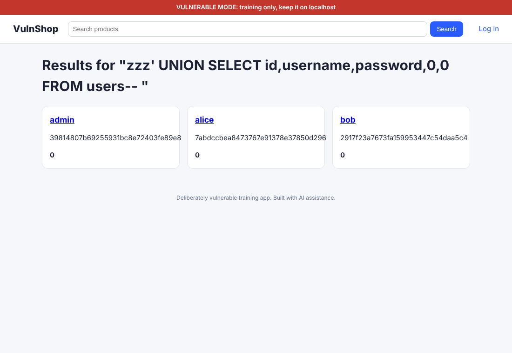
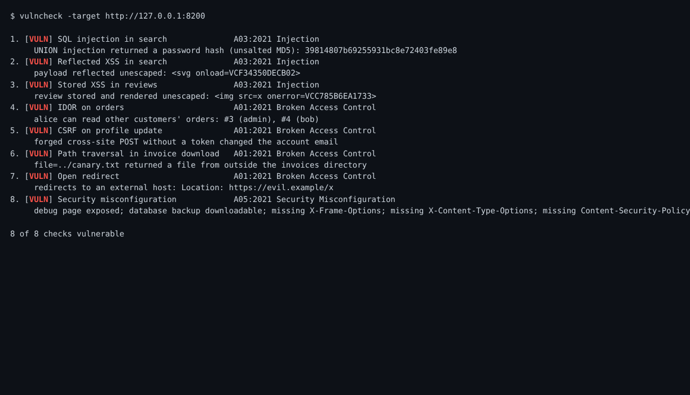
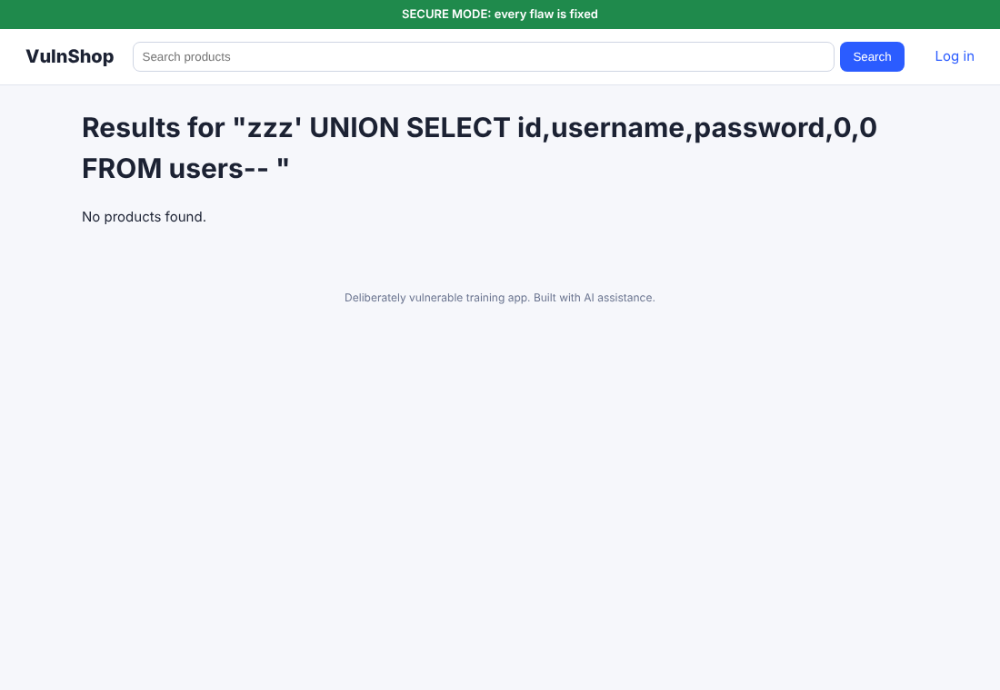
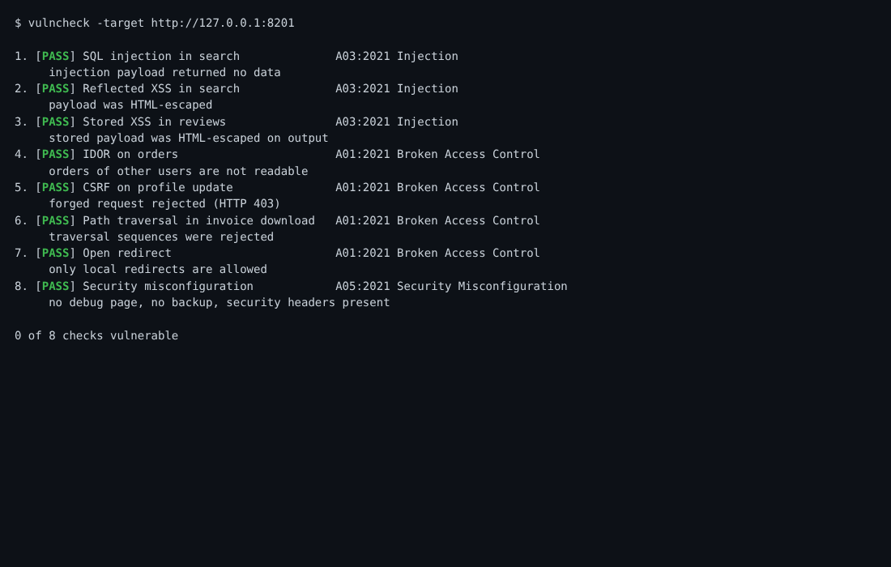

# VulnShop

[](https://github.com/jvch0512/vulnshop/actions/workflows/ci.yml)

A **deliberately vulnerable** web shop (PHP + SQLite) with eight OWASP Top 10 flaws, a **fixed version of every one of them behind a switch**, and a **Go scanner** that proves each flaw exists, and that each fix works. Built to learn attack and defense side by side.

> **Warning.** The vulnerable mode is intentionally insecure. Run it on `127.0.0.1` only, never on a shared network or the internet. Built with AI assistance (Claude).

| Vulnerable app, leaking password hashes through SQL injection | Scanner verdict on the vulnerable app |
|---|---|
|  |  |

| Same request against secure mode | Scanner verdict on the fixed app |
|---|---|
|  |  |

## Run

```bash
# vulnerable on :8200, fixed on :8201 (separate databases, run both at once)
VULNSHOP_MODE=vulnerable php -S 127.0.0.1:8200 -t public router.php &
VULNSHOP_MODE=secure     php -S 127.0.0.1:8201 -t public router.php &

# scan them (Go 1.22+, standard library only)
cd checker && go run ./cmd/vulncheck -target http://127.0.0.1:8200
cd checker && go run ./cmd/vulncheck -target http://127.0.0.1:8201
```

Test accounts: `alice` / `alice123` (used by the scanner), `bob` / `bob12345`, `admin` / `Adm1n#2026`. Needs PHP 8.1+ with `pdo_sqlite`.

## The eight flaws

Each one is marked `FLAW n` in the source with the vulnerable and the fixed code side by side.

| # | Flaw | OWASP 2021 | Where | Fix |
|---|---|---|---|---|
| 1 | SQL injection | A03 Injection | `public/search.php` | Prepared statement with bound parameter |
| 2 | Reflected XSS | A03 Injection | `public/search.php` | HTML-escape on output |
| 3 | Stored XSS | A03 Injection | `public/product.php` | HTML-escape on output |
| 4 | IDOR on orders | A01 Broken Access Control | `public/order.php` | Scope the query to the owner |
| 5 | CSRF on email change | A01 Broken Access Control | `public/profile.php` | Per-session token plus `SameSite=Lax` cookie |
| 6 | Path traversal | A01 Broken Access Control | `public/download.php` | Allowlist pattern plus `realpath` containment |
| 7 | Open redirect | A01 Broken Access Control | `public/redirect.php` | Local paths only, reject `//` and backslashes |
| 8 | Security misconfiguration | A05 | `router.php`, `public/debug.php`, headers, error output | Remove debug page and backup, add security headers, generic errors |

Chained: flaw 1 returns the password column, which in vulnerable mode is **unsalted MD5** (A02 Cryptographic Failures). Secure mode stores bcrypt via `password_hash`.

## The scanner

`checker/` is a black-box tester that sends harmless, uniquely marked probes and decides from the response, the way a real scanner does.

- Exit code `0` clean, `1` vulnerable, `2` scan could not complete. An unreachable target is an **error**, never a "secure" verdict.
- `-json` for pipelines. Works in CI to prove a fix actually closed the hole.
- **Loopback only by default.** It sends attack payloads, so a non-local target needs `-i-own-this`.
- Behaves like a browser (cookie jar, submits the anti-CSRF token the form carries), but the CSRF probe deliberately omits it, because a cross-site attacker cannot read it.
- The CSRF probe puts the victim's email back afterwards, so scans leave no side effects.

## Tests

```bash
cd checker && go test -race ./...    # checker logic against fake vulnerable and secure servers
bash tests/e2e.sh                    # real PHP app in both modes: 8 VULN vs 8 PASS, secure login still works, MD5 vs bcrypt
```

## Ideas to extend

Add a ninth flaw and make the scanner find it, switch the SQLite layer to PostgreSQL, add rate limiting to login, or put a WAF in front of the vulnerable mode and see which payloads still pass.

## License

MIT
